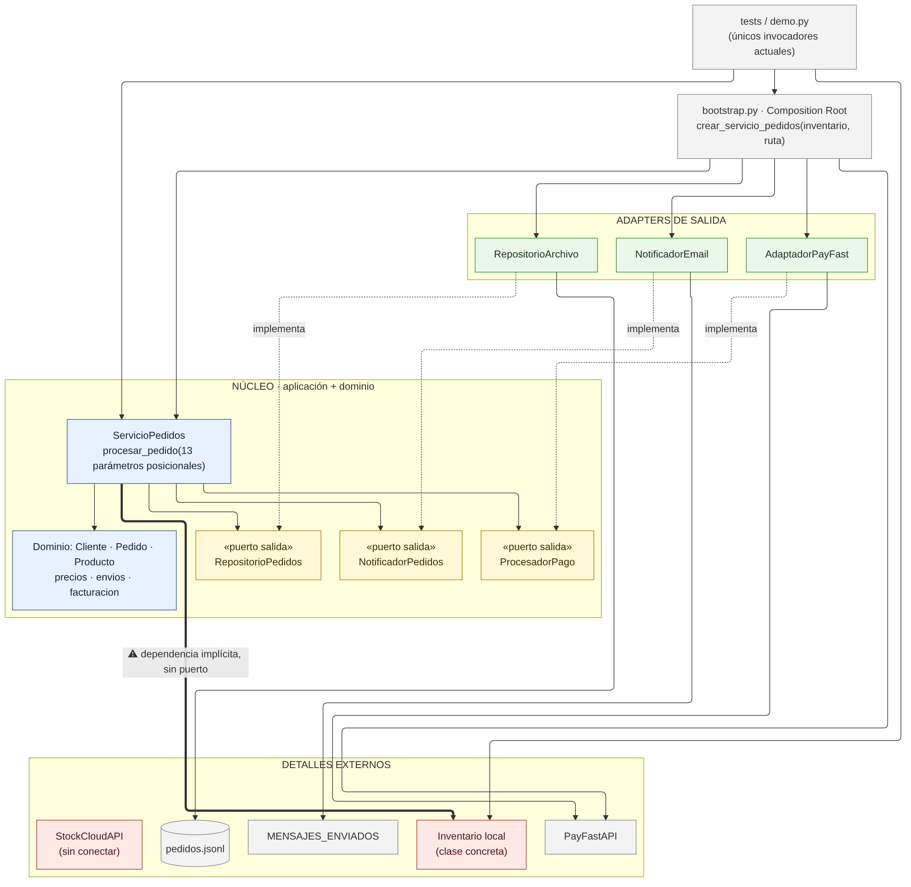
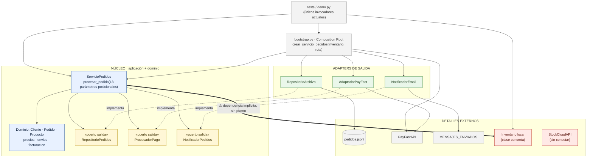

# A. Diagrama AS-IS · Punto de partida

> El bloque Mermaid de abajo es la fuente del diagrama; GitHub lo dibuja directamente. La imagen se generó con mermaid-cli (layout ELK).

Convención: `A --> B` significa **A depende de B** (lo importa, lo recibe o lo invoca).
Las flechas punteadas `-.->` indican que un adapter **implementa** un puerto (también es una dependencia: el adapter conoce el contrato del puerto).

## Lectura del diagrama

**Lo que ya está bien resuelto.** Persistencia, pagos y notificaciones cruzan la frontera del núcleo mediante puertos de salida (`RepositorioPedidos`, `ProcesadorPago`, `NotificadorPedidos`). `ServicioPedidos` no conoce `PayFastAPI`, el archivo JSONL ni la bandeja de correo: esos detalles se conectan desde `bootstrap.py`, que actúa como Composition Root.

**Lo que queda expuesto ante los nuevos requerimientos** (marcado en rojo):

1. **Inventario sin puerto.** `ServicioPedidos` recibe `inventario` sin contrato explícito. En la práctica depende de la forma concreta de `Inventario`: los métodos `validar_disponibilidad` y `reservar`, y la convención de lanzar `ValueError` cuando no hay stock. Es una dependencia real pero implícita.
2. **`StockCloudAPI` no encaja.** Ofrece `query_stock` y `reserve_units` con respuestas en diccionarios y códigos propios (`OK`, `NOT_FOUND`, `INSUFFICIENT_STOCK`, `RESERVED`…). No puede reemplazar a `Inventario` sin que alguien traduzca.
3. **No hay entradas.** Hoy el único "cliente" del caso de uso son las pruebas y la demo, que llaman `procesar_pedido` con 13 argumentos posicionales y construyen objetos `Producto` a mano. No existe un puerto de entrada ni una representación de la solicitud.
4. **`demo.py` está roto**: usa `crear_servicio_pedidos` sin importarlo.
