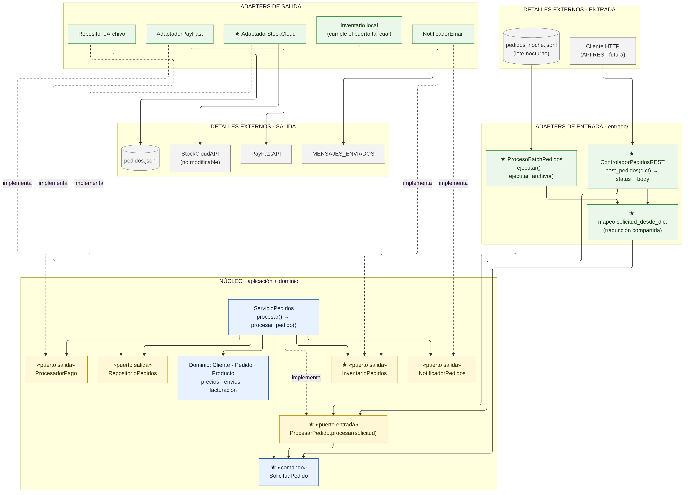
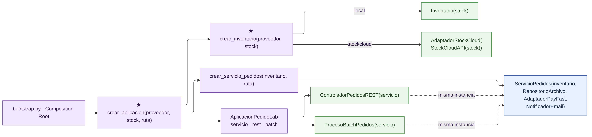
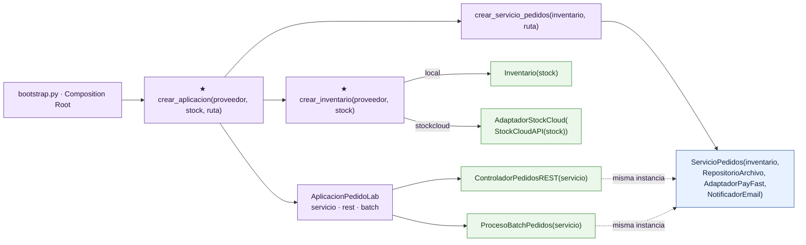

# C. Diagrama TO-BE · Después de la actividad

Convención: `A --> B` significa **A depende de B**. Las flechas punteadas indican **implementa** (el adapter depende del contrato que implementa). Los elementos marcados con ★ son nuevos.

> Las imágenes se generaron con mermaid-cli (layout ELK) a partir de los bloques Mermaid de este archivo, que GitHub también dibuja directamente.

## 1. Dependencias: entradas, núcleo y salidas

```mermaid
flowchart TB
    subgraph EXT_IN["DETALLES EXTERNOS · ENTRADA"]
        HTTP["Cliente HTTP<br/>(API REST futura)"]
        NOCHE[("pedidos_noche.jsonl<br/>(lote nocturno)")]
    end

    subgraph ADP_IN["ADAPTERS DE ENTRADA · entrada/"]
        REST["★ ControladorPedidosREST<br/>post_pedidos(dict) → status + body"]
        BATCH["★ ProcesoBatchPedidos<br/>ejecutar() · ejecutar_archivo()"]
        MAP["★ mapeo.solicitud_desde_dict<br/>(traducción compartida)"]
    end

    subgraph NUCLEO["NÚCLEO · aplicación + dominio"]
        PIN["★ «puerto entrada»<br/>ProcesarPedido.procesar(solicitud)"]
        CMD["★ «comando»<br/>SolicitudPedido"]
        S["ServicioPedidos<br/>procesar() → procesar_pedido()"]
        D["Dominio: Cliente · Pedido · Producto<br/>precios · envios · facturacion"]
        PINV["★ «puerto salida»<br/>InventarioPedidos"]
        PR["«puerto salida»<br/>RepositorioPedidos"]
        PP["«puerto salida»<br/>ProcesadorPago"]
        PN["«puerto salida»<br/>NotificadorPedidos"]
    end

    subgraph ADP_OUT["ADAPTERS DE SALIDA"]
        LOCAL["Inventario local<br/>(cumple el puerto tal cual)"]
        ASC["★ AdaptadorStockCloud"]
        AR["RepositorioArchivo"]
        AP["AdaptadorPayFast"]
        AN["NotificadorEmail"]
    end

    subgraph EXT_OUT["DETALLES EXTERNOS · SALIDA"]
        SC["StockCloudAPI<br/>(no modificable)"]
        F[("pedidos.jsonl")]
        PF["PayFastAPI"]
        M["MENSAJES_ENVIADOS"]
    end


    HTTP --> REST
    NOCHE --> BATCH
    REST --> MAP
    BATCH --> MAP
    MAP --> CMD
    REST --> PIN
    BATCH --> PIN
    PIN --> CMD

    S -. implementa .-> PIN
    S --> CMD
    S --> D
    S --> PINV
    S --> PR
    S --> PP
    S --> PN

    LOCAL -. implementa .-> PINV
    ASC -. implementa .-> PINV
    AR -. implementa .-> PR
    AP -. implementa .-> PP
    AN -. implementa .-> PN

    ASC --> SC
    AR --> F
    AP --> PF
    AN --> M


    classDef nucleo fill:#e8f1ff,stroke:#2f5d9e,color:#10233f
    classDef puerto fill:#fff7d6,stroke:#b38b00,color:#3d3000
    classDef adapter fill:#eaf7ea,stroke:#3d8b3d,color:#163816
    classDef externo fill:#f3f3f3,stroke:#888,color:#333
    classDef nuevo stroke-width:3px,stroke-dasharray:0
    classDef root fill:#f1e8ff,stroke:#6b3fa0,color:#2a1340
    class S,D,CMD nucleo
    class PIN,PINV,PR,PP,PN puerto
    class REST,BATCH,MAP,LOCAL,ASC,AR,AP,AN adapter
    class HTTP,NOCHE,SC,F,PF,M externo
```

**La lectura clave es la dirección de las flechas: todas apuntan hacia el núcleo.** Ni los adapters de entrada ni los de salida son conocidos por `ServicioPedidos`; él solo conoce puertos y el comando. Los detalles externos (HTTP, archivos, PayFast, StockCloud) solo son conocidos por su adapter.

## 2. Ensamblaje en el Composition Root

Para no cruzar el diagrama anterior con flechas de construcción, el ensamblaje se muestra aparte. `bootstrap.py` es el único lugar que conoce las clases concretas; decide el inventario por despliegue y entrega **la misma instancia** del caso de uso a ambas entradas.

## 3. Núcleo vs. detalles externos

| Zona | Elementos | ¿Cambió en esta actividad? |
|---|---|---|
| **Núcleo** | `ServicioPedidos`, dominio (`Cliente`, `Pedido`, `Producto`, precios, envíos, facturación), puertos en `puertos.py`, comando `SolicitudPedido` | Solo se **agregaron contratos**: `ProcesarPedido`, `InventarioPedidos`, `SolicitudPedido` y el método `procesar()`. La lógica de precios, envío, pago, persistencia y notificación **no se tocó**. |
| **Adapters de entrada** | `ControladorPedidosREST`, `ProcesoBatchPedidos`, `mapeo.solicitud_desde_dict` | Nuevos. Solo traducen y delegan. |
| **Adapters de salida** | `Inventario` local, `AdaptadorStockCloud`, `RepositorioArchivo`, `AdaptadorPayFast`, `NotificadorEmail` | Nuevo `AdaptadorStockCloud`. Los demás no cambiaron. |
| **Detalles externos** | Cliente HTTP, archivo nocturno, `StockCloudAPI`, `PayFastAPI`, `pedidos.jsonl`, bandeja de correo | `stockcloud_api.py` sin modificar. |
| **Composition Root** | `bootstrap.py` | Ampliado con `crear_inventario` y `crear_aplicacion`. `crear_servicio_pedidos` conserva su firma. |

## 4. Respuesta a la pregunta central

> ¿Qué partes del sistema deben cambiar y cuáles deberían permanecer estables cuando aparecen nuevos canales de entrada y un nuevo proveedor externo?

**Cambian los bordes:** se agregan adapters de entrada en un lado, un adapter de salida en el otro, y el Composition Root aprende a ensamblarlos. **Permanece estable el centro:** las reglas de negocio de `ServicioPedidos` y del dominio no cambiaron ni una línea. El núcleo solo ganó contratos explícitos (puertos y comando) que antes eran implícitos o no existían.
